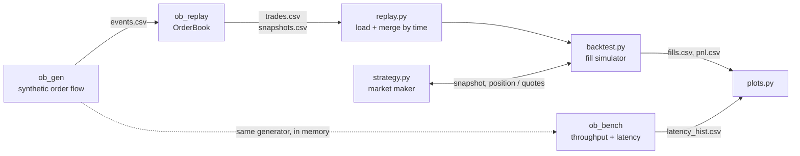
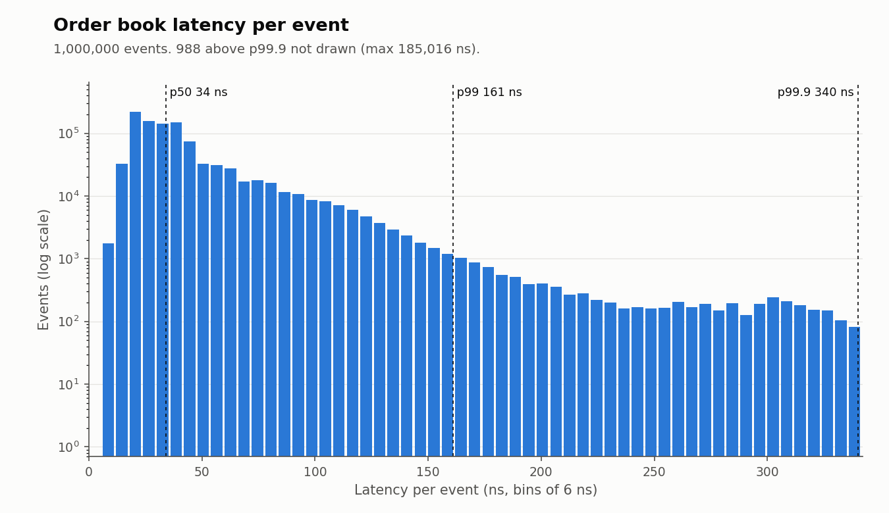
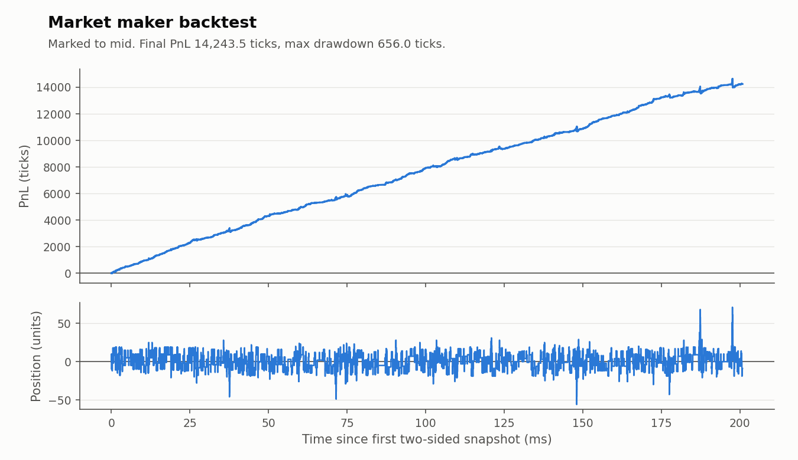

# orderbook-engine

A C++20 limit order book with price-time priority matching, tuned over five measured optimization rounds, plus a Python backtester for a market-making strategy that trades against the book's replayed output.

- **Matching engine:** limit, market, cancel and modify orders; price-time priority; integer tick prices; O(1) cancel; order nodes come from a pool, so resting and cancelling orders does not touch the global heap (the trade list returned by a match is still a `std::vector`).
- **Correctness:** unit and edge-case tests, plus a property test that replays random streams through the book and through a deliberately naive reference book and requires identical trades and depth. ASan/UBSan clean.
- **Performance:** every optimization round was benchmarked against the round before it on the same stream, and kept only if it measured faster on at least one of the two workloads. Numbers below.
- **Backtester:** an inventory-skewed market maker, simulated with order latency, queue position, fees, PnL and drawdown.
- **Real data:** a full Nasdaq trading day of AAPL (2.1 M events from the exchange's own ITCH feed) replayed through the book: 97.7% of Nasdaq's executions are reproduced exactly, and the misses trace back to one cause, explained below.
- **FPGA message parser:** a SystemVerilog decoder/validator for a 32-byte binary version of the event stream, one message per clock, checked bit-for-bit against a C++ reference model in simulation.

## Quick start

Linux or WSL2 with a C++20 compiler (GCC 11+ or Clang 14+), CMake 3.20+, Python 3.10+. Plots need matplotlib (`sudo apt install python3-matplotlib`); everything else is standard library.

```bash
scripts/run_all.sh --pin 2     # build, C++ + Python tests, benchmark, backtest, plots -> out/
```

Or step by step:

```bash
cmake -S . -B build -DCMAKE_BUILD_TYPE=Release && cmake --build build -j
ctest --test-dir build --output-on-failure
OB_BUILD_DIR=build python3 -m unittest discover -s python/tests

mkdir -p out
./build/ob_bench --pin 2 --latency-hist out/latency_hist.csv  # throughput + latency
./build/ob_gen --events 200000 --seed 1 --out out/events.csv  # synthetic order flow
python3 python/backtest.py --events out/events.csv --out-dir out
python3 python/plots.py --out-dir out
```

## Architecture



| Path | What it is |
|---|---|
| `src/order_book.{hpp,cpp}` | The book. Per side: a flat array of price levels indexed by tick, a bitmap of non-empty levels, a cached best level. Each level is an intrusive doubly linked FIFO. An open-addressing id index maps order id to its node for O(1) cancel/modify. |
| `src/pool_allocator.hpp` | Size-class free-list arena that all book nodes come from. |
| `src/event.*`, `src/generator.*` | CSV event schema (`ts_ns,type,id,side,price,qty`) and a seeded generator: Poisson arrivals, random-walk mid, two profiles (`default`, `deep`). |
| `src/replayer.*` | Replays events through the book, writes trades and depth snapshots as CSV. |
| `bench/bench.cpp` | `ob_bench`: throughput and per-event latency. |
| `src/itch.*` | Nasdaq TotalView-ITCH 5.0 parser: one symbol's messages to our event stream, plus the book rebuilt straight from the feed (`ob_itch` CLI). |
| `src/wire.*` | 32-byte binary message format, encoder, and `decode()`, the reference model for the FPGA parser (`ob_wire` CLI). |
| `fpga/` | `msg_parser.sv`, its testbench, `sim.sh` (simulate vs the C++ model) and `synth.sh` (Yosys + nextpnr report). |
| `tests/` | GoogleTest: unit, edge-case, property test vs `reference_book.hpp`, allocator, price band, id index, generator, replayer, wire format, ITCH converter. |
| `python/` | `replay.py`, `strategy.py`, `backtest.py`, `plots.py`, `itch_check.py` (real-data check), and their tests. |
| `scripts/` | `run_all.sh` (everything), `bench_rounds.sh` (re-measures every round). |

**Matching rules.** Best price first, then arrival order within a price. Trades print at the resting order's price. A market order matches until filled or the other side is empty and never rests. Reducing an order's quantity keeps its place in the queue; increasing it sends it to the back. Limit prices must lie inside the book's tick band (default 1 to 131071 ticks) or they are rejected with `PriceOutOfBand`.

## Performance

### How it is measured

`ob_bench` generates the whole stream first (untimed), warms up on a throwaway book, then:

- **Throughput:** replays the full stream R times with no per-event timing and reports the median run.
- **Latency:** replays once more with a `steady_clock` read around every event, subtracts the measured cost of a clock read, and reports p50 / p99 / p99.9.

It refuses to run unless built in Release (`-O3 -DNDEBUG`) and pins itself to one core with `--pin`. It also prints a checksum (trades, traded quantity, rejects); every round below produced identical checksums, so each one did exactly the same work.

Two order-flow profiles, 1M events each, seed 1:

- **default:** 60% limit / 30% cancel / 10% market. Orders cluster near the mid and get matched or cancelled fast, so only ~250 orders rest at a time. The whole book fits in L1 cache.
- **deep:** 70% limit / 25% cancel / 5% market, prices spread ~50 ticks from the mid. Resting orders build up to ~208k, so memory layout starts to matter.

### Results

All six rounds, measured back to back in one session: 7 passes, 1M events, 3 throughput repeats per run, pinned to one core. "vs previous round" compares each round with the one before it *within the same pass*, which cancels most of the machine's drift; "faster than previous" counts the passes where it won.

**Default profile** (book fits in L1)

| Round | M events/s | range | vs r0 | vs previous round | faster than previous | p50 ns | p99 ns | p99.9 ns |
|---|---:|---:|---:|---:|---:|---:|---:|---:|
| r0 baseline (std::map + std::list) | 9.9 | 8.6-12.0 | 1.00x | - | - | 70 | 273 | 522 |
| r1 node pool allocator | 13.8 | 11.8-14.9 | 1.39x | 1.38x | 7/7 passes | 58 | 273 | 515 |
| r2 intrusive level queues | 14.2 | 12.2-16.7 | 1.43x | 1.11x | 5/7 passes | 56 | 235 | 429 |
| r3 flat price-tick arrays | 19.1 | 17.5-22.7 | 1.93x | 1.39x | 7/7 passes | 39 | 233 | 433 |
| r4 open-addressing id index | 22.6 | 19.1-25.1 | 2.27x | 1.12x | 5/7 passes | 36 | 183 | 350 |
| r5 32-byte order node | 24.6 | 17.3-26.0 | 2.48x | 1.06x | 5/7 passes | 39 | 252 | 446 |

**Deep profile** (~208k resting orders)

| Round | M events/s | range | vs r0 | vs previous round | faster than previous | p50 ns | p99 ns | p99.9 ns |
|---|---:|---:|---:|---:|---:|---:|---:|---:|
| r0 baseline (std::map + std::list) | 2.7 | 2.1-3.0 | 1.00x | - | - | 233 | 1356 | 2506 |
| r1 node pool allocator | 2.9 | 2.5-3.9 | 1.09x | 1.15x | 5/7 passes | 220 | 1323 | 4404 |
| r2 intrusive level queues | 3.6 | 3.1-5.2 | 1.36x | 1.21x | 6/7 passes | 203 | 1376 | 4571 |
| r3 flat price-tick arrays | 4.9 | 3.3-6.2 | 1.82x | 1.30x | 6/7 passes | 103 | 1163 | 4061 |
| r4 open-addressing id index | 6.5 | 6.0-9.4 | 2.44x | 1.45x | 6/7 passes | 166 | 679 | 1565 |
| r5 32-byte order node | 9.1 | 6.2-10.3 | 3.43x | 1.19x | 5/7 passes | 105 | 681 | 1068 |

Reproduce with `scripts/bench_rounds.sh --passes 7` (results in `out/rounds/`).

**Reading the table:**

- **Overall:** 2.5x throughput on the L1-resident book and 3.4x on the deep book, with p99.9 latency down from 2.5 µs to 1.1 µs on the deep book.
- **Clear wins:** r1 (pool) and r3 (flat arrays) beat the previous round in every pass on the default profile. r4 (flat id index) is the biggest single step on the deep book.
- **Small steps:** r2, r4 and r5 on the default profile, and r5 on the deep profile, beat the previous round in only 5 or 6 of 7 passes, so on their own they are close to this machine's noise. r2 and r4 also won clearly in head-to-head runs when they were made. r5 did not on the default profile (a null result at the time); it was kept because it won on the deep book, where its p99.9 is also the best of any round.
- **A tail-latency regression I found while writing this up:** on the deep book, rounds r1 to r3 have a *worse* p99.9 than the baseline (about 4 µs vs 2.5 µs, in every pass), even though their throughput is higher. It goes away in r4, which replaced `std::unordered_map` as the id index, so the old index is the likely cause; I have not confirmed it.



*Final book (r5), default profile, from a separate `scripts/run_all.sh --pin 2` run (23.8 M events/s; p50 34, p99 161, p99.9 340 ns). It is a different session from the table above, so the numbers differ slightly.*

### What each round changed

| Round | Change | Why it helps |
|---|---|---|
| r0 | `std::map<Price, std::list<Order>>` per side, `std::unordered_map` id index | Simple, obviously correct baseline (tag `v0.1-baseline`). |
| r1 | Node pool allocator for list, map and index nodes | Book nodes no longer go through `malloc`/`free` on every add and cancel. `std::pmr::unsynchronized_pool_resource` was tried first and was slower than the baseline. |
| r2 | Intrusive doubly linked queue per level; index points straight at the node | Cancel unlinks in O(1) without a list iterator; one allocation per order instead of several. |
| r3 | Flat array of levels indexed by price tick, bitmap of non-empty levels, cached best price | Price lookup becomes an array index instead of a tree walk; finding the next best level scans 64 levels per bitmap word. Costs a fixed tick band. |
| r4 | Open-addressing id index (linear probing, power-of-two table, backward-shift deletion) | Replaces `std::unordered_map`'s node-per-entry chains with one flat array. |
| r5 | Order node shrunk from 56 to 32 bytes (id, qty, prev, next) | Side and price are implied by the level that holds the node. Twice as many nodes per cache line. No measurable effect on the L1-resident default profile; a real gain on the deep book. |

### Caveats

- Measured on a laptop (Intel Core Ultra 7 155U) under WSL2, g++ 13.3. Absolute speed drifts by 30% or more between sessions on this machine, so every number in the table comes from one interleaved session (`scripts/bench_rounds.sh`: each round is built from its own commit with the same harness and the same stream, and the starting round rotates every pass). Compare rows within the table, not against numbers from other runs.
- **Max latency is not reported.** In the runs I recorded it ranged from about 0.16 to 1.2 ms, with the slowest event landing at a different point in the stream each time. An idle loop doing nothing but 100M clock reads on the same VM shows gaps of up to 2 ms, so those spikes come from the WSL2 host, not the book. p99.9 is the tail metric used here.
- Single-threaded, in-memory, no network or parsing in the timed path.

## Backtest

`strategy.py` quotes one bid and one ask around a reservation price that leans against its inventory (long inventory moves both quotes down). Sizes are capped so a full fill never breaks the position limit. `backtest.py` replays the book's trades and snapshots in time order and decides when those quotes would have filled.

200k events (seed 1), quotes 1 tick either side of the reservation price, 10 units per quote, position limit 100, skew of 1 tick per 10 units held. PnL is in ticks, marked to mid.

| Fill assumptions | Fills | Volume | Max position | PnL | Max drawdown |
|---|---:|---:|---:|---:|---:|
| Default: 5 µs latency, queue model, no fee | 4,049 | 32,589 | 71 | +14,243.5 | 656.0 |
| Fill only when a trade goes through our price | 2,977 | 23,788 | 72 | +7,567.0 | 695.0 |
| Fee of 0.2 ticks per unit | 4,049 | 32,589 | 71 | +7,725.7 | 681.0 |
| 50 µs latency | 1,328 | 10,322 | 29 | +4,189.0 | 450.0 |
| All three: trade-through only, 0.2 fee, 50 µs | 1,052 | 8,097 | 33 | **-958.9** | 1,847.1 |
| 500 µs latency | 1 | 10 | 10 | +545.0 | 500.0 |

What this shows is how much the result depends on the fill model, not that the strategy works. Each conservative assumption on its own cuts the PnL by half or more, and all three together make it negative. With 500 µs of latency (about 500 events at this flow rate) the quotes are always stale by the time they land, and almost nothing fills. That single fill's PnL is just a 10-unit position marked to mid.



Reproduce: `scripts/run_all.sh`, or `python3 python/backtest.py --events out/events.csv --out-dir out [--trade-through-only] [--fee 0.2] [--latency-ns 50000]`.

## Real data: one Nasdaq day

The synthetic generator cannot show whether the book matches the way a real exchange does. Nasdaq publishes sample days of TotalView-ITCH 5.0, the binary feed it sends to trading firms: every displayed order's add, execution, cancel, delete and replace, with the order's reference number and a nanosecond timestamp. The file used here is Thursday 30 January 2020 (5.6 GB compressed, 423,285,709 messages, all stocks), from Nasdaq's public sample directory.

**Method.** `ob_itch` streams the file once and keeps one symbol (AAPL: 2,008,972 messages, 2,144,609 events after conversion). Adds, cancels, deletes and replaces map onto our events directly. Each execution becomes a market order on the opposite side, so the C++ book has to decide which resting order fills; Nasdaq's message names the order it actually filled. Alongside, `ob_itch` rebuilds the book straight from the messages. `itch_check.py` replays the events through `ob_replay` and compares:

- **fills:** for each of the 55,168 executions, the same resting order at the same price in a single trade;
- **depth:** the top 5 levels per side after every one of the 2,144,609 events, against the rebuilt book.

| | Compared | Identical | |
|---|---:|---:|---:|
| Executions, 04:00 to 09:30 (pre-market) | 2,240 | 2,240 | 100% |
| Executions, 09:30:00 to 09:30:01 | 17 | 17 | 100% |
| Executions, 09:30 to 16:00 | 52,306 | 51,038 | 97.58% |
| Executions, 16:00 to 20:00 (after hours) | 605 | 605 | 100% |
| **All executions** | **55,168** | **53,900** | **97.70%** |
| Top-5 depth after each event | 2,144,609 | 2,137,368 | 99.66% |

**Where the 1,268 misses come from.** All of them fall in regular hours, in bursts. In the minute after the open, 24,112 AAPL orders appear in the feed with reference numbers *older* than orders already resting, in batches of about 90 per timestamp. They were entered earlier and released into the book after the opening cross. The fills show Nasdaq queuing them by that original entry, ahead of orders that reached the feed first. The C++ book queues by arrival, the only order the feed shows directly, so it fills the other order at that price. 859 of the misses involve one of these released orders directly. The other 409 are knock-on effects: once a different order has filled, the two books hold different orders at that level until those orders leave. The same divergence accounts for the 20 rejected events (Nasdaq cancels an order our book already filled) and 15 trades Nasdaq did not have. Pre-market, after hours and the 09:30:00 second match completely.

Not modelled: the 227 executions at a price other than the order's own (the opening and closing crosses) are applied as reductions of the named order, since the book has no auction. Hidden and cross trades (15,116) do not change the displayed book and are only counted. 34 adds at sub-cent prices are skipped along with their follow-ups.

```bash
mkdir -p ~/itch && curl -L -C - -o ~/itch/01302020.NASDAQ_ITCH50.gz \
  "https://emi.nasdaq.com/ITCH/Nasdaq%20ITCH/01302020.NASDAQ_ITCH50.gz"   # 5.6 GB, keep it outside the repo
zcat ~/itch/01302020.NASDAQ_ITCH50.gz | build/ob_itch --symbol AAPL --out-dir out/itch-aapl   # ~5 min, zcat-bound
python3 python/itch_check.py --dir out/itch-aapl --build-dir build                            # ~5 s, writes itch_check.json
```

## FPGA message parser

The first step of a hardware feed handler: take a binary message off the wire, check it, and hand the fields on. `fpga/rtl/msg_parser.sv` reads one 32-byte message per clock from a 256-bit bus (format in `src/wire.hpp`), checks type, side, price band, quantity and reserved bytes, and outputs the fields with an error code plus per-type and error counters. Two pipeline stages, so 2 cycles of latency, no backpressure (a market-data feed cannot be paused), and input bubbles are allowed on any cycle.

**Verification.** `ob::decode()` in C++ is the reference model. `fpga/sim.sh` encodes a generated stream with `ob_wire`, corrupts one random byte in every 50th message, and puts a fixed set of boundary cases first (exact price bounds, every error code). Then it runs the Icarus Verilog testbench with random input gaps and requires the hardware output to match `ob_wire decode` line for line, along with the counters. On 100,037 messages (743 invalid) the output is identical, and the testbench sees exactly 2 cycles of latency on every message. Four hand-made RTL bugs (dropped zero-price check, dropped rule in the error flag, wrong error code, dropped reserved check) each fail the run. Verilator `-Wall` lint is clean.

**Synthesis** (`fpga/synth.sh`; tool reports only, no board). Lattice iCE40 HX8K, Yosys + nextpnr: 670 logic cells (8% of the device). Post-route maximum clock is 146 to 157 MHz across five placement seeds, i.e. about 146 M messages/s at one message per clock. The parser's ~660 I/O bits do not fit on the chip's pins, so `timing_wrap.sv` drives it from a shift register and folds the outputs into a parity bit, only so place-and-route has real paths to time. Two changes took Fmax from about 114 MHz to this: since the band is 1 to 2^17−1, "price ≤ max" becomes "no bit above 16 is set" instead of a 32-bit compare, and the counters' enable reads a registered all-ok bit instead of the output of the error priority encoder.

```bash
sudo apt install iverilog verilator yosys nextpnr-ice40
fpga/sim.sh       # needs a build (ob_gen, ob_wire)
fpga/synth.sh
```

Not done: no real network interface (Ethernet/UDP framing), no order book in hardware, and nothing has run on a physical board.

## Simplifications and limitations

The backtester's results are optimistic, mainly because of the first point:

- **No adverse selection.** The synthetic order flow does not know where the price is heading, so a passive quote is never picked off by informed traders. On real data a market maker's fills are biased against it; here they are not. Treat the PnL as a test of the plumbing and the fill model, not as evidence the strategy makes money.
- **No market impact.** The strategy's orders are simulated next to the replayed book, never inserted into it.
- **Queue position is approximated** from aggregated depth: a new order joins the back of its level, and when the level shrinks the cancels are assumed to be ahead of us (optimistic). The trade-through-only setting removes this assumption.
- **Passive fills only.** An order that would cross the book on arrival is dropped, never filled as a taker.
- **Fixed latency** for every order action, no jitter. PnL is marked to the mid with no exit cost.
- **Synthetic data for the backtest.** The book itself is checked on a real Nasdaq day (above), but the strategy is only backtested on generated flow. The generator is a random walk with Poisson arrivals; it has no intraday pattern, no volatility clustering and no real queue dynamics.
- **Book limits:** fixed tick band chosen at construction; resting order timestamps are not stored (the book never reads them); one instrument; single-threaded.

## What I learned

- **Measure before and after every change, in the same session.** The same round 4 code ran at about 23 M events/s one day and 32 M the next. The machine drifted by more than most of the changes I was measuring, so only interleaved comparisons count.
- **Library tools are not automatically fast.** `std::pmr`'s pool resource was slower than the default allocator here; a small hand-written free list was faster than both.
- **The workload decides what matters.** Shrinking the order node did nothing while the whole book sat in L1, and only showed up once a deeper profile pushed it out to main memory. A benchmark that is too easy hides layout effects.
- **A naive reference implementation makes rewrites safe.** Every round replaced a core data structure; the property test against a linear-scan book, run after each one, is what made that practical.
- **Tail latency on a VM is mostly the VM.** Before blaming the code for a 1 ms spike, time an empty loop.
- **A backtest is only as honest as its fill model.** Most of `backtest.py` is about when an order would *not* fill: latency, queue position, crossing quotes.

## License

MIT, see [LICENSE](LICENSE).
